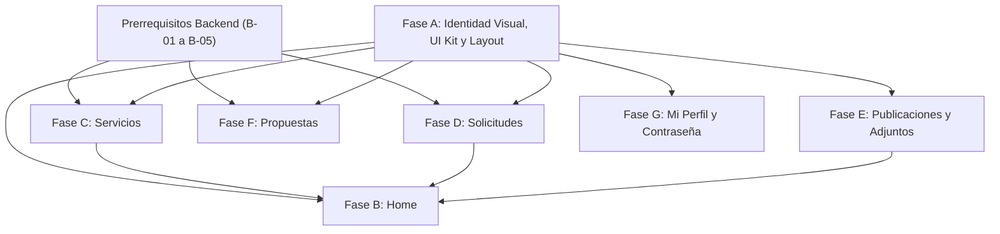

# Plan Técnico — Spec 002: Rediseño de Interfaz y Fases A–G

- **Especificación asociada**: `frontend/specs/002-interfaz/spec.md`
- **Stack Frontend**: React 19 + Vite 8 + TypeScript 5.9 (`strict: true`) + Tailwind CSS v4 + React Router v7 + Axios + Vitest / Testing Library
- **Stack Backend**: Node.js + Express 5 + Sequelize 6 + PostgreSQL (Supabase) + Zod

---

## 1. Arquitectura Frontend Propuesta

Siguiendo los lineamientos de `frontend/docs/ARQUITECTURA-FRONTEND.md` y la base consolidada en `001-authentication`, extenderemos la arquitectura en capas al resto de los dominios de negocio:

```text
frontend/src/
├── domain/                     # Contratos de dominio puros (TypeScript interfaces, tipos y helpers)
│   ├── roles.ts                # (Existente) Rol, ROL, esPersonalCIT, labelDeRol
│   ├── auth.ts                 # (Existente) User, Profile, LoginCredentials...
│   ├── catalogos.ts            # (Nuevo) Sector, Estado, CodigoEstado
│   ├── servicios.ts            # (Nuevo) Servicio, CreateServicioInput, ServicioFilters
│   ├── solicitudes.ts          # (Nuevo) Solicitud, EstadoSolicitud, SolicitudFilters
│   ├── publicaciones.ts        # (Nuevo) Publicacion, ArchivoAdjunto, TipoContenido, PublicacionFilters
│   ├── propuestas.ts           # (Nuevo) Propuesta, DictamenInput, CreatePropuestaInput
│   └── perfil.ts               # (Nuevo) UpdateProfileInput, ChangePasswordInput
├── lib/                        # Infraestructura transversal
│   ├── http.ts                 # (Existente) Cliente Axios con interceptores JWT Bearer y 401
│   ├── storage.ts              # (Existente) Persistencia de token
│   ├── errors.ts               # (Existente/Ampliado) Mapeo de errores HTTP/API a español
│   └── formatters.ts           # (Nuevo) Formato de fechas, moneda ARS ($ / "Consultar"), iniciales
├── repositories/               # Capa HTTP + Mapeo DTO Backend (snake_case/Sequelize) -> Dominio (camelCase)
│   ├── auth.repository.ts      # (Existente)
│   ├── catalogos.repository.ts # (Nuevo) GET /sectores, GET /estados
│   ├── servicios.repository.ts # (Nuevo) GET /servicios, POST /servicios
│   ├── solicitudes.repository.ts # (Nuevo) GET /solicitudes, POST /solicitudes, PATCH /solicitudes/:id/estado
│   ├── publicaciones.repository.ts # (Nuevo) CRUD /publicacion(es) + POST/DELETE /archivos
│   ├── propuestas.repository.ts # (Nuevo) GET /propuestas, POST /propuesta/crear, PATCH /propuesta/:id/dictamen
│   └── perfil.repository.ts    # (Nuevo) PUT /profile/:userId, PUT /change-password
├── services/                   # Casos de uso, validaciones previas al envío y lógica de negocio
│   ├── auth.service.ts         # (Existente)
│   ├── catalogosService.ts     # (Refactorizado sobre repository)
│   ├── serviciosService.ts     # (Refactorizado sobre repository)
│   ├── solicitudesService.ts   # (Refactorizado sobre repository)
│   ├── publicacionesService.ts # (Refactorizado sobre repository)
│   ├── propuestasService.ts    # (Refactorizado sobre repository)
│   └── profileService.ts       # (Refactorizado sobre repository + changePassword)
├── components/
│   ├── Layout.tsx              # Shell principal estilo GitHub (TopHeader + Sidebar responsivo + Outlet)
│   ├── ProtectedRoute.tsx      # (Existente) Guard de rutas autenticadas y roles
│   └── ui/                     # (Nuevo) Sistema de componentes base reutilizables
│       ├── Button.tsx          # Variantes: primary (#238636), secondary (#21262d), danger (#da3633), ghost
│       ├── Badge.tsx           # Variantes semánticas para estados, sectores y roles
│       ├── Card.tsx            # Contenedor con fondo #161b22 y borde #30363d
│       ├── PageHeader.tsx      # Cabecera de página con título, subtítulo, contador y slot de acciones
│       ├── SearchFilterBar.tsx # Barra combinada de búsqueda por texto + selectores de filtro
│       ├── EmptyState.tsx      # Estado vacío con ícono SVG, título, descripción y CTA opcional
│       ├── Alert.tsx           # Banner contextual (error, success, warning, info)
│       ├── Skeleton.tsx        # Placeholders animados para estados de carga
│       └── Modal.tsx           # Diálogo accesible con cierre por Escape/backdrop
└── pages/                      # Vistas por fase (Fases A–G)
```

> **Justificación técnica**: Mantener los nombres de archivo de `src/services/*Service.ts` y sus firmas públicas (o re-exportarlas) evita romper importaciones existentes durante la transición, mientras que encapsular los DTOs de Sequelize en `repositories/` aísla el frontend de los alias en mayúscula (`Sector`, `Estado`, `Solicitante`, `Autor`, `Archivo`).

---

## 2. Sistema de Diseño Visual (Inspiración GitHub Dark)

Se actualizará `frontend/src/index.css` empleando directivas `@theme` de **Tailwind CSS v4** para definir variables semánticas:

| Token CSS / Tailwind | Valor Hex | Uso en la Interfaz |
| :--- | :--- | :--- |
| `--color-gh-canvas` | `#0d1117` | Fondo general de la aplicación (`body`, área principal de contenido) |
| `--color-gh-surface` | `#161b22` | Fondo de tarjetas (`Card`), `Sidebar`, `TopHeader`, cabeceras de tabla |
| `--color-gh-elevated` | `#21262d` | Inputs, botones secundarios, estados `hover` de filas y menús |
| `--color-gh-border` | `#30363d` | Bordes divisorios de `1px solid` en tarjetas, tablas, inputs y layout |
| `--color-gh-border-muted`| `#21262d` | Separadores internos de listas y tablas |
| `--color-gh-text` | `#e6edf3` | Texto principal de alta legibilidad |
| `--color-gh-muted` | `#8b949e` | Texto secundario, metadatos, fechas y etiquetas de formulario |
| `--color-cit-accent` | `#238636` | Botón primario de acción (verde institucional estilo GitHub Primary Button) |
| `--color-cit-accent-hover`| `#2ea043` | Hover de botón primario y bordes de foco |
| `--color-status-pending` | `#d29922` | Badge/indicador para estado `PENDIENTE` (Ámbar) |
| `--color-status-success` | `#3fb950` | Badge/indicador para `APROBADO`, `ACEPTADA`, `FINALIZADA` (Verde) |
| `--color-status-danger` | `#f85149` | Badge/indicador para `RECHAZADO` y acciones destructivas (Rojo) |
| `--color-status-info` | `#58a6ff` | Enlaces, indicadores informativos y badges de sector (Azul) |

---

## 3. Estrategia de Navegación y Rutas (`App.tsx` y `Layout.tsx`)

### 3.1 Mapa de Rutas
Se conserva el esquema de rutas de React Router v7 en `frontend/src/App.tsx`:
- Rutas públicas:
  - `/login` → `Login.tsx`
  - `/register` → `Register.tsx`
- Rutas protegidas (`ProtectedRoute` dentro de `Layout`):
  - `/` → `Home.tsx` (Fase B)
  - `/servicios` → `Servicios.tsx` (Fase C — catálogo, filtros y contratación)
  - `/servicios/:id` → `ServicioDetalle.tsx` (Fase C — detalle, contratación, calificaciones y reseñas)
  - `/solicitudes` → `Solicitudes.tsx` (Fase D — bandeja interna exclusiva `cit`/`admin` para evaluación de propuestas de organismos y conversión automática en servicio)
  - `/publicaciones` → `Publicaciones.tsx` (Fase E — espacio de publicaciones institucionales: noticias, jornadas, inscripciones, capacitaciones y boletines técnicos, con estados publicada/borrador y ABM para `cit`/`admin`)
  - `/publicaciones/:id` → `PublicacionDetalle.tsx` (Fase E — lectura editorial detallada, galería multimedia con lightbox y gestión de recursos adjuntos)
  - `/propuestas` → `Propuestas.tsx` (Fase F — presentación institucional de propuestas de organizaciones para rol `user` con formulario de 8 campos, adjunto validado y seguimiento conectado con Fase D)
  - `/perfil` → `Perfil.tsx` (Fase G — información personal editable con protección de rol/email, cambio de contraseña y secciones de actividad privada: Mis Propuestas, Mis Servicios y Mis Capacitaciones)
  - `*` → Redirección limpia a `/`

### 3.2 Estructura del Shell (`Layout.tsx`)
- **TopHeader (`h-16`)**:
  - Izquierda: Botón hamburguesa (visible en `< md`), logo de CITio + nombre de plataforma y separador `/ {Sección Actual}`.
  - Derecha: Badge del rol (`labelDeRol(user.rol)`), avatar circular (imagen `avatarUrl` o iniciales sobre fondo `#21262d`), nombre del usuario con enlace a `/perfil` y botón de cierre de sesión.
- **Sidebar (`w-64` en desktop, Drawer superpuesto con backdrop en móvil)**:
  - Ítems de navegación agrupados con íconos SVG (`Inicio`, `Servicios`, `Solicitudes`, `Publicaciones`, `Propuestas`, y sección inferior `Mi perfil`).
  - Indicador lateral izquierdo de `3px` en color `#2ea043` y fondo `#21262d` para la ruta activa.

---

## 4. Integración con Autenticación JWT y Permisos por Rol

- **Autenticación JWT**: Se utiliza sin modificaciones el flujo cerrado en Spec-001 (`http.ts` inyecta `Authorization: Bearer <token>` desde `storage.ts`, y ante un `401` en rutas privadas dispara `AUTH_UNAUTHORIZED_EVENT`, limpiando sesión y redirigiendo a `/login` con aviso de sesión expirada).
- **Control de Permisos en UI**:
  - Se centraliza la verificación mediante los helpers de `src/domain/roles.ts`:
    - `esPersonalCIT(user.rol)`: Habilita acciones de gestión tanto para `cit` como para `admin` (crear servicios, cambiar estado de solicitudes, ABM de publicaciones y adjuntos, dictaminar propuestas).
    - `user.rol === ROL.USER`: Habilita acciones exclusivas de solicitante externo (solicitar un servicio, enviar una nueva propuesta).

---

## 5. Integración con Endpoints Existentes y Cambios Necesarios en el Backend

A continuación se detalla el mapa completo de endpoints, identificando qué funciona hoy y los ajustes puntuales requeridos en el backend para que el frontend pueda operar sin errores:

### 5.1 Endpoints que ya funcionan sin cambios
1. `GET /api/sectores` y `GET /api/estados` (`catalogos.routes.ts`)
2. `POST /api/solicitudes` y `PATCH /api/solicitudes/:id/estado` (`solicitudes.routes.ts`)
3. `GET /api/publicaciones`, `GET /api/publicacion/:id`, `POST /api/publicacion`, `PUT /api/publicacion/:id`, `DELETE /api/publicacion/:id` (`publicaciones.routes.ts`)
4. `POST /api/publicacion/:publicacionId/archivos` y `DELETE /api/archivo/:id` (`publicaciones.routes.ts`)
5. `POST /api/propuesta/crear` y `PATCH /api/propuesta/:id/dictamen` (`propuestas.routes.ts`)
6. `GET /api/profile`, `PUT /api/profile/:userId` y `PUT /api/change-password` (`profile.routes.ts` y `auth.routes.ts`)

### 5.2 Ajustes Indispensables en el Backend (Bugs e Integración)

| # | Archivo Backend | Problema Actual | Cambio Técnico Propuesto |
| :- | :--- | :--- | :--- |
| **B-01** | `backend/src/routes/index.ts` | `serviciosRouter` está importado pero no montado (`404` en `/api/servicios`). | Agregar `routes.use("/", serviciosRouter);` junto al resto de los routers. |
| **B-02** | `backend/src/routes/servicios.routes.ts` | `POST /api/servicios` solo tiene `requireAuth`, falta `requireCIT`. | Cambiar a `serviciosRouter.post("/servicios", requireAuth, requireCIT, createServicio);`. |
| **B-03** | `backend/src/repositories/solicitud.repository.ts` | `findAll` no incluye el modelo `User` (`as: "Solicitante"`), impidiendo que el CIT vea quién pidió el servicio. | Agregar `{ model: User, as: "Solicitante", attributes: { exclude: ["password"] }, include: [{ model: Profile, as: "Profile" }] }` al arreglo `includes`. |
| **B-04** | `backend/src/routes/propuestas.routes.ts`, `propuesta.controller.ts`, `propuesta.service.ts`, `propuesta.repository.ts` | `GET /api/propuestas` exige `requireCIT` y solo devuelve estado `PENDIENTE`. El rol `user` no puede ver sus propuestas enviadas ni su dictamen; el CIT no puede ver propuestas ya dictaminadas. | Permitir `requireAuth` en `GET /api/propuestas`: si `req.user.role === "user"`, devolver las propuestas donde `solicitante === req.user.id` (todos los estados); si es `cit` o `admin`, devolver todas las propuestas (todos los estados) ordenadas por `createdAt DESC`. |
| **B-05** | `backend/src/models/servicio.model.ts` | `servicio_nombre` es `DataTypes.STRING(30)`, insuficiente para nombres reales de ensayos del CIT (`Servicios.md`). | Ampliar a `DataTypes.STRING(120)` en el modelo Sequelize (y documentar el `ALTER TABLE` si la columna en Supabase tiene restricción `varchar(30)`). |

---

## 6. Modelos, Relaciones y Gestión de Archivos Adjuntos

### 6.1 Modelos y Relaciones
- No se requiere crear tablas nuevas ni eliminar modelos existentes.
- Las relaciones definidas en `backend/src/models/index.ts` ya contemplan todas las asociaciones necesarias:
  - `Solicitud.belongsTo(User, { foreignKey: "user_id", as: "Solicitante" })`
  - `Publicacion.hasMany(ArchivoPublicacion, { foreignKey: "publicacion_id", as: "Archivo", onDelete: "CASCADE" })`
  - `Propuesta.belongsTo(User, { foreignKey: "solicitante", as: "Solicitante" })` y `belongsTo(User, { foreignKey: "cit_revisor", as: "Revisor" })`

### 6.2 Estrategia para Archivos Adjuntos (`ArchivoPublicacion`)
El modelo `ArchivoPublicacion` almacena:
- `tipo`: `"imagen" | "video"`
- `archivo_url`: `string` (`TEXT`)
- `archivo_nombre`: `string` (`VARCHAR(255)`)
- `orden`: `number` (`INTEGER`, default `0`)

En **Fase E (`PublicacionDetalle.tsx` y `Publicaciones.tsx`)**:
1. **Visualización**:
   - Los adjuntos con `tipo === "imagen"` se renderizan en una grilla de tarjetas con previsualización `` (con fallback elegante si la URL falla al cargar) y opción de abrir en tamaño completo en un `Modal` (lightbox) o pestaña nueva.
   - Los adjuntos con `tipo === "video"` se renderizan con reproductor `<video controls>` si la URL es un archivo directo (`.mp4`, `.webm`) o como tarjeta de video/enlace embebido si es una URL externa (YouTube/Vimeo/Drive).
2. **Alta y Baja de Adjuntos (exclusivo `cit`/`admin`)**:
   - En `PublicacionDetalle.tsx`, el personal CIT dispondrá de una sección **"Gestionar archivos adjuntos"** con formulario inline/modal para añadir un archivo (`tipo`, `archivo_nombre`, `archivo_url`, `orden`) invocando `POST /api/publicacion/:publicacionId/archivos` y botón de eliminación con confirmación por cada adjunto invocando `DELETE /api/archivo/:id`.

---

## 7. Estrategia de Estados, Flujos de Trabajo y Manejo de Errores

### 7.1 Estados Semánticos Unificados
El componente `<Badge />` mapeará automáticamente los códigos de `Estado` y `TipoContenido` a variantes visuales consistentes:
- `PENDIENTE` → Variante `warning` (fondo ámbar translúcido, texto `#d29922`, borde ámbar sutil).
- `APROBADO` / `ACEPTADA` / `FINALIZADA` → Variante `success` (fondo verde translúcido, texto `#3fb950`).
- `RECHAZADO` → Variante `danger` (fondo rojo translúcido, texto `#f85149`).
- Sectores (`AGRICOLA`, `GANADERO`, `FRUTIHORTICOLA`) → Variante `info` (azul `#58a6ff`).
- Tipos de contenido (`patologia`, `enfermedad`, `parasito`, `plaga`, `otro`) → Variante `neutral` / `purple`.

### 7.2 Gestión de Errores y Validaciones
- Se reutilizará y ampliará `frontend/src/lib/errors.ts` (`traducirError`) para traducir cualquier mensaje de error del backend (ej. `"Proposal already reviewed"`, `"Current password is incorrect"`, `"Missing required fields"`, `"Forbidden: insufficient permissions"`) al español claro antes de mostrarlo en componentes `<Alert variant="error" />`.
- Todos los formularios validarán campos obligatorios y formatos en cliente antes de disparar peticiones HTTP, deshabilitando el botón de envío (`loading={submitting}`) para evitar envíos duplicados.

---

## 8. Estrategia de Pruebas

Se utilizará la infraestructura ya configurada en Spec-001 (**Vitest + React Testing Library + jsdom**):
1. **Tests unitarios de Dominio y Formateadores (`src/__tests__/domain/`)**:
   - Formateo de precios (`$ 15.000` vs `"Consultar"` cuando es `0`), fechas y mapeo de DTOs en repositorios.
2. **Tests de Componentes UI y Layout (`src/__tests__/components/`)**:
   - Renderizado de `Layout` verificando elementos visibles según rol (`user` vs `cit` vs `admin`).
   - Componentes `Badge`, `EmptyState`, `SearchFilterBar`.
3. **Tests de Integración de Páginas por Fase (`src/__tests__/pages/`)**:
   - **Fase B (`Home.test.tsx`)**: Renderizado de KPIs y accesos rápidos diferenciados por rol.
   - **Fase C (`Servicios.test.tsx`)**: Filtro por sector/búsqueda, botón "Solicitar" para `user` y formulario de creación para `cit`.
   - **Fase D (`Solicitudes.test.tsx`)**: Filtro por estado, visualización de columna Solicitante y cambio de estado para `cit`.
   - **Fase E (`Publicaciones.test.tsx`)**: Filtro por tipo de contenido/sector y gestión de archivos adjuntos en detalle.
   - **Fase F (`Propuestas.test.tsx`)**: Envío y listado de propuestas propias para `user`; dictamen con justificación obligatoria para `cit`.
   - **Fase G (`Perfil.test.tsx`)**: Edición de perfil y validación del formulario de cambio de contraseña (`PUT /api/change-password`).

---

## 9. Dependencias entre Fases



1. **Fase A** (Tokens CSS, componentes UI base y `Layout`) es la base estructural sobre la que se apoyan todas las demás fases.
2. **Los ajustes de Backend (`B-01` a `B-05`)** desbloquean la integración real de las Fases C, D y F.
3. **Fases C, D, E, F y G** pueden implementarse secuencialmente una vez completada la Fase A.
4. **Fase B (Home)** consume los servicios/repositorios de Servicios, Solicitudes, Publicaciones y Propuestas para armar el panel de resumen, por lo que resulta óptimo consolidarla junto con la capa de repositorios.

---

## 10. Riesgos Técnicos y Mitigación

| Riesgo Identificado | Impacto | Estrategia de Mitigación |
| :--- | :---: | :--- |
| **R-01**: Desajuste entre el esquema de Supabase en la nube y los modelos Sequelize (como ocurrió con `Users.isActive` en Spec-001). | Alto | No agregar columnas nuevas innecesarias. Para `servicio_nombre`, verificar si existe restricción `VARCHAR(30)` en Supabase y proveer la sentencia SQL `ALTER TABLE` si fuera necesario. |
| **R-02**: Ruptura de los 26 tests existentes de Spec-001 al rediseñar estilos globales (`index.css`, `Login.tsx`, `Register.tsx`). | Medio | Mantener intactos los `labels`, `roles` ARIA, textos de botones y rutas evaluados por los tests de `001-authentication`, ejecutando `npm test` tras cada fase. |
| **R-03**: Fallo parcial de carga en `Home.tsx` si alguno de los endpoints de resumen demora o falla (ej. `/propuestas` para un rol específico). | Medio | Utilizar `Promise.allSettled()` en lugar de `Promise.all()` en el dashboard de `Home.tsx`, de modo que cada widget muestre su propio estado sin bloquear toda la pantalla. |
| **R-04**: URLs de imágenes externas rotas o inválidas cargadas por usuarios en Servicios, Publicaciones o Avatar. | Bajo | Implementar manejo de `onError` en los componentes `` para mostrar un placeholder institucional limpio en lugar del ícono de imagen rota del navegador. |
