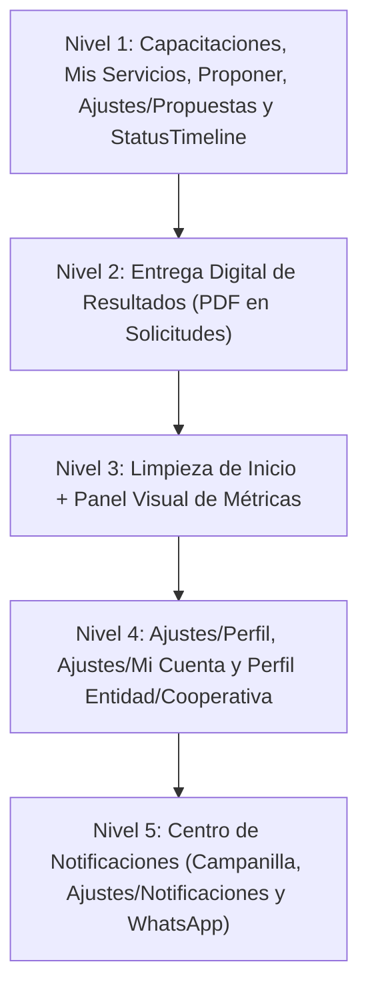

# Plan de Implementación — Spec-003: Experiencia de Usuario en 5 Niveles

- **Especificación vinculada**: `frontend/specs/003-experiencia-usuario/spec.md`
- **Tareas vinculadas**: `frontend/specs/003-experiencia-usuario/task.md`
- **Estado**: Niveles 1 a 5 implementados y verificados

---

## 1. Arquitectura General por Niveles

---

## 2. Diseño Técnico Detallado — Nivel 1

### 2.1 Backend (Express + Sequelize)

1. **Cancelación de Propuestas y Solicitudes por el Usuario**:
   - `PATCH /api/propuestas/:id/cancelar` en `backend/src/routes/propuestas.routes.ts`, `propuesta.controller.ts` y `propuesta.service.ts`:
     - Verifica que `propuesta.solicitante === req.user.id`.
     - Verifica que el estado actual sea `PENDIENTE` (o `EN_REVISION` antes de dictamen).
     - Asegura la existencia del estado `CANCELADA` (`ensureEstado(ESTADO.CANCELADA, "Cancelada")`) y actualiza `propuesta.estado_id`.
   - `PATCH /api/solicitudes/:id/cancelar` en `backend/src/routes/solicitudes.routes.ts`, `solicitud.controller.ts` y `solicitud.service.ts`:
     - Verifica que `solicitud.user_id === req.user.id`.
     - Verifica que el estado actual sea `PENDIENTE`.
     - Pasa la solicitud al estado `CANCELADA`.

2. **Gestión de Inscripciones a Capacitaciones**:
   - Endpoints existentes en `backend/src/routes/profile.routes.ts`:
     - `GET /api/mis-capacitaciones`
     - `POST /api/capacitaciones/:publicacionId/inscribirse`
   - Nuevos endpoints para completar la gestión formativa por `cit`/`admin`:
     - `GET /api/capacitaciones/:publicacionId/inscriptos` (`requireAuth`, `requireRole(ROL.CIT, ROL.ADMIN)`): lista los inscriptos de una capacitación con datos de usuario/perfil.
     - `PATCH /api/capacitaciones/inscripciones/:id/estado` (`requireAuth`, `requireRole(ROL.CIT, ROL.ADMIN)`): actualiza `estado` (`INSCRIPTO` | `EN_CURSO` | `FINALIZADO`) y `observaciones` de una inscripción.

### 2.2 Frontend (React 19 + TypeScript + Tailwind CSS)

1. **Componente `StatusTimeline` (`frontend/src/components/ui/StatusTimeline.tsx`)**:
   - Recibe `steps: TimelineStep[]` o helpers preconfigurados para `Solicitud` y `Propuesta`.
   - Muestra visualmente cada etapa con ícono de estado (`done`, `current`, `upcoming`, `rejected`, `cancelled`), etiqueta, fecha y descripción/responsable.
   - Exportado desde `frontend/src/components/ui/index.ts`.

2. **Contratos, Repositorios y Servicios**:
   - `frontend/src/repositories/propuestas.repository.ts` & `frontend/src/services/propuestasService.ts`: agregar `cancelarPropuesta(id: number)`.
   - `frontend/src/repositories/solicitudes.repository.ts` & `frontend/src/services/solicitudesService.ts`: agregar `cancelarSolicitud(id: number)`.
   - `frontend/src/repositories/perfil.repository.ts` & `frontend/src/services/profileService.ts`: agregar `listarInscriptosCapacitacion(publicacionId)` y `actualizarEstadoInscripcionCapacitacion(inscripcionId, payload)`.

3. **Nuevas Páginas y Reestructuración UX**:
   - **`frontend/src/pages/Capacitaciones.tsx`**:
     - Filtra publicaciones de tipo formativo (`capacitacion`, `jornada`, `inscripcion`), con búsqueda por texto y filtro por sector.
     - Permite al usuario autenticado inscribirse en 1 clic y ver su estado actual (`Inscripto`, `En curso`, `Finalizado`).
     - Para `cit`/`admin`, incluye botón para crear actividad formativa o abrir el modal de gestión de inscriptos y actualizar su progreso.
   - **`frontend/src/pages/MisServicios.tsx`**:
     - Vista unificada con dos secciones/pestañas claras:
       1. **Servicios contratados (`Solicitud[]`)**: tarjeta con sector, arancel, fecha, `StatusTimeline`, enlace a `/servicios/:id`, botón **Cancelar solicitud** (si `PENDIENTE`) y opción de eliminar.
       2. **Mis capacitaciones (`InscripcionCapacitacion[]`)**: tarjeta con estado formativo (`INSCRIPTO` → `EN_CURSO` → `FINALIZADO`), fecha de inscripción, observaciones y enlace al detalle.
   - **`frontend/src/pages/Propuestas.tsx` (Ruta `/proponer`)**:
     - Actualiza título y encabezados a **Proponer**.
     - Muestra el formulario de presentación de propuesta directamente para usuarios `user` (sin listar las propuestas enviadas debajo) y destaca el botón/enlace **«Ver tus propuestas»** que dirige a `/ajustes/propuestas`.
   - **`frontend/src/pages/Ajustes.tsx`**:
     - Layout de **Ajustes** con barra de subsecciones (`/ajustes/propuestas`, `/ajustes/perfil`, `/ajustes/notificaciones`, `/ajustes/mi-cuenta`), dejando completamente funcional en el Nivel 1 la vista **`/ajustes/propuestas`** (listado de propuestas propias, detalles, dictamen del CIT, `StatusTimeline`, botón **Cancelar propuesta** cuando está `PENDIENTE`/`EN_REVISION` y opción de eliminar) y acceso rápido a perfil para las subsecciones que se expanden en los Niveles 4 y 5.
   - **`frontend/src/components/Layout.tsx` y `frontend/src/App.tsx`**:
     - Barra lateral actualizada con: `Inicio`, `Servicios`, `Capacitaciones`, `Mis Servicios` (autenticados), `Proponer`, `Publicaciones`, `Solicitudes` (solo `cit`/`admin`) y `Mi Perfil`.
     - Barra superior con botón de **tuerquita ⚙️ (`Ajustes`)** al lado del acceso a Mi Perfil.
     - Rutas registradas en `App.tsx`: `/capacitaciones`, `/mis-servicios`, `/proponer`, `/propuestas` (redirige a `/proponer`), `/ajustes`, `/ajustes/:seccion`.

---

## 3. Avance Planificado para Niveles 2 a 5

- **Nivel 2**: Subida y descarga protegida de archivos de resultado en `Solicitud` + hito de descarga en `StatusTimeline` dentro de `MisServicios.tsx`.
- **Nivel 3**: Limpieza de bloques estáticos en `Home.tsx` + endpoint `GET /api/metricas/resumen` + dashboard visual de KPIs.
- **Nivel 4**: Botón «Editar perfil» en `Perfil.tsx` → `/ajustes/perfil` (datos personales, avatar, contraseña, datos de Entidad/Cooperativa y WhatsApp) + `/ajustes/mi-cuenta` (eliminar cuenta) + solicitudes/propuestas en representación de productores asociados.
- **Nivel 5**: Campanilla 🔔 en `Layout.tsx` + `/notificaciones` + `/ajustes/notificaciones` + proveedor WhatsApp integrado a `OutboxNotification`.
