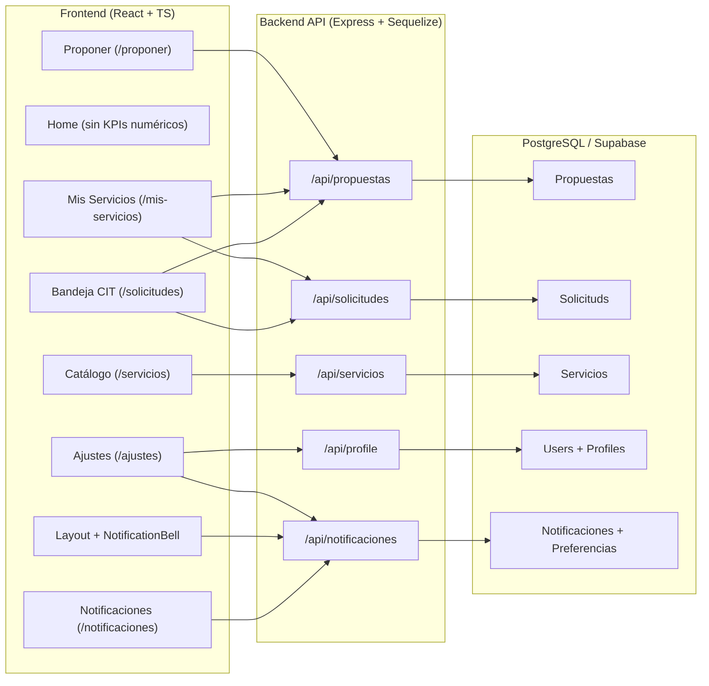

# Plan de Implementación — Spec-003: Experiencia de Usuario, Gestión Personal y Administración Completa

- **Especificación vinculada**: `frontend/specs/003-experiencia-usuario/spec.md`
- **Tareas vinculadas**: `frontend/specs/003-experiencia-usuario/task.md`
- **Fecha**: 2026-11-12
- **Estado**: En revisión / Pendiente de aprobación

---

## 1. Resumen Arquitectónico

La arquitectura de **Spec-003** mantiene la separación en capas establecida en **Spec-002**:

1. **Frontend (React 19 + TypeScript + Vite + React Router v6)**:
   - Capa de dominio y contratos tipados (`frontend/src/domain/`).
   - Capa de repositorios HTTP (`frontend/src/repositories/`).
   - Capa de servicios de aplicación (`frontend/src/services/`).
   - Componentes UI reutilizables (`frontend/src/components/ui/`) y layout institucional (`frontend/src/components/Layout.tsx`).
   - Vistas de páginas protegidas o públicas según matriz de roles (`frontend/src/pages/`).

2. **Backend (Node.js + Express 5 + TypeScript + Sequelize + PostgreSQL/Supabase)**:
   - Rutas (`backend/src/routes/`) protegidas con `requireAuth`, `optionalAuth`, `requireUser`, `requireCitOrAdmin`, `requireRole`.
   - Controladores HTTP (`backend/src/controllers/`).
   - Servicios de negocio (`backend/src/services/`) con validaciones de estado, rol, propiedad e integridad transaccional.
   - Repositorios de acceso a datos (`backend/src/repositories/`).
   - Modelos Sequelize (`backend/src/models/`) y migraciones SQL idempotentes (`backend/src/config/migrations/`).

---

## 2. Componentes Existentes Reutilizables

Se reutilizarán sin duplicación los siguientes componentes y utilidades existentes:

| Componente / Módulo | Ubicación | Uso en Spec-003 |
|---|---|---|
| `Button`, `Card`, `Badge`, `Alert`, `EmptyState`, `Skeleton`, `PageHeader`, `SearchFilterBar`, `Modal` | `frontend/src/components/ui/` | Tablas, tarjetas de seguimiento en **Mis Servicios**, pestañas de **Ajustes**, modales de confirmación de cancelación/eliminación y centro de **Notificaciones**. |
| `ProtectedRoute` | `frontend/src/components/ProtectedRoute.tsx` | Protección de `/proponer` (`roles={["user"]}`), `/mis-servicios`, `/ajustes`, `/notificaciones` (autenticados) y `/solicitudes` (`roles={["cit", "admin"]}`). |
| `AuthContext` | `frontend/src/context/AuthContext.tsx` | Lectura de rol activo (`user`, `cit`, `admin`), refresco de perfil (`refreshUser`) y cierre de sesión automático tras eliminar cuenta (`logout`). |
| `ThemeContext` | `frontend/src/context/ThemeContext.tsx` | Integración directa con la subsección **Preferencias visuales** dentro de `/ajustes` (alternancia y persistencia de modo claro/oscuro). |
| `httpClient` | `frontend/src/lib/httpClient.ts` | Cliente HTTP centralizado con inyección de JWT y manejo uniforme de errores. |

---

## 3. Componentes y Páginas Frontend a Modificar

| Archivo | Cambios Planificados | Fase |
|---|---|---|
| `frontend/src/pages/Home.tsx` | Eliminar el bloque `statsStrip` (`+35 Servicios Técnicos`, `4 Áreas Estratégicas`, `100% Trazabilidad Digital`, `Abierto a Organizaciones`) y el estilo `.statsStrip` en `Home.module.css`. Reemplazar por una franja cualitativa de pilares institucionales sin cifras estáticas ni contadores numéricos. | Fase A |
| `frontend/src/components/Layout.tsx` | 1. Renombrar ítem de navegación `"Propuestas"` a `"Proponer"` apuntando a `/proponer` para `user`. 2. Reemplazar ítem `"Mi Perfil"` por `"Ajustes"` (`/ajustes`) y `"Mis Servicios"` (`/mis-servicios`) en la barra y menú de usuario. 3. Incorporar el componente `<NotificationBell />` en la cabecera para usuarios autenticados. | Fases B, C, D, G |
| `frontend/src/App.tsx` | 1. Registrar rutas `/ajustes`, `/mis-servicios`, `/proponer`, `/notificaciones`. 2. Configurar redirecciones `<Navigate to="/ajustes" replace />` desde `/perfil` y `<Navigate to="/proponer" replace />` desde `/propuestas` para mantener retrocompatibilidad de enlaces. | Fases B, C, D, G |
| `frontend/src/pages/Propuestas.tsx` (renombrada o reexportada como `Proponer.tsx`) | Actualizar encabezados a **Proponer**, simplificar la vista enfocándola en la presentación de nuevas propuestas organizacionales y agregar enlace directo a **Mis Servicios → Servicios propuestos** (`/mis-servicios?tab=propuestos`) tras enviar una propuesta. | Fase C |
| `frontend/src/pages/Servicios.tsx` | 1. Corregir enlace `"Ver seguimiento"` (línea 220) para que apunte a `/mis-servicios?tab=solicitados` en lugar de `/solicitudes`. 2. Para `cit`/`admin`, agregar filtro por estado de catálogo (`ACTIVO`, `ARCHIVADO`, `CANCELADO`) y acciones en cada tarjeta para **Archivar**, **Cancelar** (con modal de motivo) o **Reactivar**. 3. Mostrar badge de estado de catálogo cuando un servicio esté `ARCHIVADO` o `CANCELADO`. | Fases D, E, F |
| `frontend/src/pages/ServicioDetalle.tsx` | 1. Corregir enlaces `"Ver seguimiento"` / `"Ir a seguimiento"` (líneas 232 y 407) hacia `/mis-servicios?tab=solicitados`. 2. Si el servicio está `ARCHIVADO` o `CANCELADO`, mostrar aviso institucional y deshabilitar contratación para `user`, permitiendo controles de cambio de estado para `cit`/`admin`. | Fases D, E, F |
| `frontend/src/pages/Solicitudes.tsx` | Incorporar selector de pestaña superior en la bandeja interna CIT/Admin: - **Pestaña 1: Solicitudes de Servicios (`Solicitud`)**: listado filtrable por estado, cambio de estado (`PENDIENTE`, `EN_REVISION`, `ACEPTADA`, `RECHAZADA`, `FINALIZADA`, `CANCELADA`), edición de `observaciones_cit` (visibles al usuario) y `observaciones_internas` (privadas CIT/Admin). - **Pestaña 2: Propuestas de Organizaciones (`Propuesta`)**: flujo existente de revisión, aprobación con publicación en catálogo y rechazo. | Fase E |
| `frontend/src/domain/servicios.ts`, `solicitudes.ts`, `propuestas.ts` | Extender interfaces TypeScript con `estado_servicio`, `motivo_cancelacion`, `observaciones_cit`, `observaciones_internas`, `fecha_cancelacion` y estado `CANCELADA`. | Fases D, E, F |

---

## 4. Componentes y Páginas Frontend Nuevos a Crear

| Archivo Nuevo | Responsabilidad | Fase |
|---|---|---|
| `frontend/src/pages/Ajustes.tsx` + `Ajustes.module.css` | Página central de configuración personal con navegación lateral/tabs para 4 subsecciones: 1. **Perfil** (nombre, apellido, teléfono, biografía, correo solo lectura, rol solo lectura). 2. **Notificaciones** (switches conectados a `PUT /api/notificaciones/preferencias`). 3. **Preferencias visuales** (selector de tema Claro / Oscuro conectado a `ThemeContext`). 4. **Eliminar cuenta** (zona de peligro con modal de confirmación por contraseña + palabra `"ELIMINAR"` conectado a `POST /api/profile/eliminar-cuenta`). Incluye sección informativa complementaria de **Mis Capacitaciones** inscriptas. | Fase B |
| `frontend/src/pages/MisServicios.tsx` + `MisServicios.module.css` | Panel unificado de gestión de servicios del usuario con dos pestañas: 1. **Servicios propuestos**: tabla/tarjetas de propuestas creadas por el usuario, estado, fecha, área, modal de detalle con comentarios de revisión CIT y botón **Cancelar propuesta** (solo si `PENDIENTE`). 2. **Servicios solicitados**: tabla/tarjetas de solicitudes de contratación, estado actual, fechas, modal de seguimiento con `observaciones_cit`, enlace a la ficha del servicio y botón **Cancelar solicitud** (solo si `PENDIENTE`). | Fase D |
| `frontend/src/components/NotificationBell.tsx` + `NotificationBell.module.css` | Ícono de campana en el `Layout` con contador de no leídas (`badge`), desplegable rápido con las últimas 5 notificaciones, acción `"Marcar todas como leídas"` y enlace a `/notificaciones`. | Fase G |
| `frontend/src/pages/Notificaciones.tsx` + `Notificaciones.module.css` | Historial completo de notificaciones del usuario con filtro (`Todas` / `No leídas`), marcado individual o masivo de lectura, navegación al recurso asociado (`enlace`) y, para `cit`/`admin`, formulario modal para emitir un aviso de `ACTUALIZACION_PLATAFORMA`. | Fase G |
| `frontend/src/domain/notificaciones.ts` | Tipos `NotificacionItem`, `TipoNotificacion`, `PreferenciasNotificacion`, `CreateAnuncioPayload`. | Fase G |
| `frontend/src/repositories/notificaciones.repository.ts` & `frontend/src/services/notificacionesService.ts` | Cliente HTTP y lógica de acceso para listar notificaciones, contar no leídas, marcar como leída(s), leer/guardar preferencias y emitir anuncios de plataforma. | Fase G |

---

## 5. Endpoints Existentes a Modificar

| Método y Ruta | Archivo Backend | Modificación Planificada | Roles |
|---|---|---|---|
| `GET /api/servicios` | `servicio.controller.ts` / `servicio.service.ts` / `servicio.repository.ts` | - Si el solicitante es anónimo o `user`: filtrar por defecto `estado_servicio = 'ACTIVO'`. - Si el solicitante es `cit` o `admin` (vía `optionalAuth` en la ruta pública): permitir query param `?estado_servicio=ACTIVO\|ARCHIVADO\|CANCELADO\|TODOS`. | Público (`optionalAuth`) |
| `GET /api/servicios/:id` | `servicio.controller.ts` / `servicio.service.ts` | Incluir `estado_servicio` y `motivo_cancelacion` en la respuesta. | Público (`optionalAuth`) |
| `POST /api/solicitudes` | `solicitud.service.ts` | 1. Verificar que el servicio exista y tenga `estado_servicio === 'ACTIVO'` (rechazar con `400 Bad Request` si está `ARCHIVADO` o `CANCELADO`). 2. Al crearse la solicitud, disparar notificación interna `ACTIVIDAD_USUARIO` para personal `cit`/`admin`. | `user` |
| `GET /api/solicitudes` | `solicitud.controller.ts` / `solicitud.service.ts` | - Para `user`: devolver sus solicitudes incluyendo `observaciones_cit` y `fecha_cancelacion`, pero **excluyendo** `observaciones_internas`. - Para `cit`/`admin`: devolver todas las solicitudes incluyendo datos de solicitante (`User.username`, `User.email`, `Profile`), servicio y tanto `observaciones_cit` como `observaciones_internas`. | `user`, `cit`, `admin` |
| `PATCH /api/solicitudes/:id/estado` | `solicitudes.routes.ts` / `solicitud.controller.ts` / `solicitud.service.ts` | 1. Aceptar en el body `{ estado: string, observaciones_cit?: string, observaciones_internas?: string }`. 2. Validar matriz de transiciones de estado (`PENDIENTE` -> `EN_REVISION` / `ACEPTADA` / `RECHAZADA` / `CANCELADA`; `EN_REVISION` -> `ACEPTADA` / `RECHAZADA` / `CANCELADA`; `ACEPTADA` -> `FINALIZADA` / `CANCELADA`). 3. Generar notificación `ACTIVIDAD_USUARIO` para el `user_id` titular de la solicitud. | `cit`, `admin` |
| `PATCH /api/propuestas/:id/aprobar` y `PATCH /api/propuestas/:id/rechazar` | `propuesta.service.ts` | Disparar notificación `CAMBIO_ESTADO_PROPUESTA` al `solicitante` (si tiene activa la preferencia `cambios_propuestas`). Si se aprueba y crea servicio en catálogo, disparar además `NUEVO_SERVICIO` a usuarios con `nuevos_servicios = true`. | `cit`, `admin` |
| `POST /api/servicios` | `servicio.service.ts` | Al crear un servicio nuevo con `estado_servicio = 'ACTIVO'`, disparar notificación `NUEVO_SERVICIO` a los usuarios que tengan `nuevos_servicios = true`. | `cit`, `admin` |
| `POST /api/publicaciones` y `PUT /api/publicaciones/:id` | `publicacion.service.ts` | Cuando una publicación se crea con `publicado = true` (o pasa de `false` a `true`), disparar notificación `NUEVA_PUBLICACION` a los usuarios con `noticias_publicaciones = true`. | `cit`, `admin` |

---

## 6. Endpoints Nuevos a Crear

| Método y Ruta | Controlador / Servicio | Descripción y Reglas | Roles Permitidos |
|---|---|---|---|
| `PATCH /api/propuestas/:id/cancelar` | `propuesta.controller.ts` / `propuesta.service.ts` | Cancela una propuesta del usuario autenticado. Verifica `propuesta.solicitante === req.user.id` y que el estado actual sea `PENDIENTE`. Cambia estado a `CANCELADA`. | `user` (propietario) |
| `PATCH /api/solicitudes/:id/cancelar` | `solicitud.controller.ts` / `solicitud.service.ts` | Cancela una solicitud de servicio del usuario autenticado. Verifica `solicitud.user_id === req.user.id` y estado actual `PENDIENTE`. Cambia estado a `CANCELADA`, registra `fecha_cancelacion = new Date()` y `cancelado_por_id = req.user.id`. | `user` (propietario) |
| `PATCH /api/servicios/:id/estado-catalogo` | `servicio.controller.ts` / `servicio.service.ts` | Cambia `estado_servicio` entre `'ACTIVO'`, `'ARCHIVADO'` y `'CANCELADO'`. Si pasa a `'CANCELADO'`, acepta `motivo_cancelacion` opcional. Actualiza `fecha_cambio_estado = new Date()`. No afecta solicitudes previas en curso. | `cit`, `admin` |
| `POST /api/profile/eliminar-cuenta` | `profile.controller.ts` / `profile.service.ts` | Recibe `{ password: string, confirmacion: "ELIMINAR" }`. 1. Si es el único `admin` activo del sistema, rechaza con `409 Conflict`. 2. Verifica contraseña con `bcrypt.compare`. 3. En transacción Sequelize: pasa propuestas y solicitudes `PENDIENTE` del usuario a `CANCELADA`, anonimiza PII (`username`, `email`, `password`, `document_url`, `Profile`), marca `isActive = false`. | `user`, `cit`, `admin` |
| `GET /api/notificaciones` | `notificacion.controller.ts` / `notificacion.service.ts` | Lista las notificaciones del usuario autenticado ordenadas por `createdAt DESC`, junto con `unreadCount` y soporte de filtro `?soloNoLeidas=true` y límite `?limit=50`. | `user`, `cit`, `admin` |
| `PATCH /api/notificaciones/:id/leer` | `notificacion.controller.ts` / `notificacion.service.ts` | Marca una notificación propia (`user_id === req.user.id`) como `leida = true`, `fecha_lectura = new Date()`. | `user`, `cit`, `admin` |
| `PATCH /api/notificaciones/leer-todas` | `notificacion.controller.ts` / `notificacion.service.ts` | Marca todas las notificaciones no leídas del usuario autenticado como `leida = true`. | `user`, `cit`, `admin` |
| `GET /api/notificaciones/preferencias` | `notificacion.controller.ts` / `notificacion.service.ts` | Obtiene las preferencias de notificación del usuario (creando el registro con valores por defecto `true` si aún no existe). | `user`, `cit`, `admin` |
| `PUT /api/notificaciones/preferencias` | `notificacion.controller.ts` / `notificacion.service.ts` | Actualiza los booleanos `noticias_publicaciones`, `cambios_propuestas`, `nuevos_servicios`, `actualizaciones_plataforma`, `actividad_usuario` del usuario autenticado. | `user`, `cit`, `admin` |
| `POST /api/notificaciones/anuncio` | `notificacion.controller.ts` / `notificacion.service.ts` | Permite a `cit` o `admin` emitir una notificación institucional de tipo `ACTUALIZACION_PLATAFORMA` (`{ titulo, mensaje, enlace? }`) a todos los usuarios activos con `actualizaciones_plataforma = true`. | `cit`, `admin` |

---

## 7. Cambios en Modelos y Base de Datos

### 7.1 Catálogo `Estados` (`backend/src/constants/estados.ts` y `catalogSeed.service.ts`)
- Agregar constante `CANCELADA: "Cancelada"` en `ESTADO`.
- Asegurar su creación idempotente con `Estado.findOrCreate({ where: { tipo: "Cancelada" } })` en `ensureCatalogSeed()`.

### 7.2 Modelo `Solicitud` (`backend/src/models/solicitud.model.ts`, tabla `"Solicituds"`)
Nuevas columnas:
- `observaciones_cit`: `DataTypes.TEXT`, `allowNull: true` (observaciones visibles para el usuario solicitante).
- `observaciones_internas`: `DataTypes.TEXT`, `allowNull: true` (notas internas exclusivas de `cit`/`admin`).
- `fecha_cancelacion`: `DataTypes.DATE`, `allowNull: true`.
- `cancelado_por_id`: `DataTypes.INTEGER`, `allowNull: true`, FK opcional a `"Users"("id")`.

### 7.3 Modelo `Servicio` (`backend/src/models/servicio.model.ts`, tabla `"Servicios"`)
Nuevas columnas:
- `estado_servicio`: `DataTypes.STRING(20)`, `allowNull: false`, `defaultValue: "ACTIVO"` (valores válidos: `'ACTIVO' | 'ARCHIVADO' | 'CANCELADO'`).
- `motivo_cancelacion`: `DataTypes.TEXT`, `allowNull: true`.
- `fecha_cambio_estado`: `DataTypes.DATE`, `allowNull: true`.

### 7.4 Nuevo Modelo `Notificacion` (`backend/src/models/notificacion.model.ts`, tabla `"Notificaciones"`)
Columnas:
- `id`: `INTEGER`, PK, autoincremental.
- `user_id`: `INTEGER`, `allowNull: false`, FK a `"Users"("id")` `ON DELETE CASCADE`.
- `tipo`: `STRING(50)`, `allowNull: false` (`'NUEVA_PUBLICACION' | 'CAMBIO_ESTADO_PROPUESTA' | 'NUEVO_SERVICIO' | 'ACTUALIZACION_PLATAFORMA' | 'ACTIVIDAD_USUARIO'`).
- `titulo`: `STRING(200)`, `allowNull: false`.
- `mensaje`: `TEXT`, `allowNull: false`.
- `enlace`: `STRING(255)`, `allowNull: true`.
- `referencia_tipo`: `STRING(50)`, `allowNull: true` (`'publicacion' | 'propuesta' | 'servicio' | 'solicitud' | 'sistema'`).
- `referencia_id`: `INTEGER`, `allowNull: true`.
- `leida`: `BOOLEAN`, `allowNull: false`, `defaultValue: false`.
- `fecha_lectura`: `DATE`, `allowNull: true`.
- `createdAt`, `updatedAt`: `DATE`.

### 7.5 Nuevo Modelo `PreferenciaNotificacion` (`backend/src/models/preferenciaNotificacion.model.ts`, tabla `"PreferenciasNotificaciones"`)
Columnas:
- `id`: `INTEGER`, PK, autoincremental.
- `user_id`: `INTEGER`, `allowNull: false`, `unique: true`, FK a `"Users"("id")` `ON DELETE CASCADE`.
- `noticias_publicaciones`: `BOOLEAN`, `allowNull: false`, `defaultValue: true`.
- `cambios_propuestas`: `BOOLEAN`, `allowNull: false`, `defaultValue: true`.
- `nuevos_servicios`: `BOOLEAN`, `allowNull: false`, `defaultValue: true`.
- `actualizaciones_plataforma`: `BOOLEAN`, `allowNull: false`, `defaultValue: true`.
- `actividad_usuario`: `BOOLEAN`, `allowNull: false`, `defaultValue: true`.
- `createdAt`, `updatedAt`: `DATE`.

---

## 8. Estrategia de Migraciones Versionadas, Idempotentes y Despliegue

### 8.1 Archivo Canónico y Reglas de Ejecución
- **Archivo SQL canónico**: `backend/src/config/migrations/003_spec003_ux_management.sql`.
- **Wrapper TypeScript**: `backend/src/migrations/20261112-spec003-ux-management.ts` (con interfaz `up/down` de Sequelize).
- **Regla de no concurrencia de herramientas**: **No** debe ejecutarse simultáneamente el SQL directo y su wrapper TypeScript. Debe utilizarse exclusivamente una de las dos vías por entorno.
- **Sin ejecución automática en el arranque**: La migración **no** se ejecuta de manera implícita al iniciar el backend. Debe revisarse y aplicarse de forma manual y controlada **una sola vez por entorno** (desarrollo, staging, producción).
- **Advertencia crítica sobre el Rollback**: El bloque de reversión (`DOWN`) descarta columnas y tablas con datos (`DROP TABLE "PreferenciasNotificaciones"`, `DROP TABLE "Notificaciones"`, `DROP COLUMN ...`). **No debe ejecutarse sin autorización expresa y respaldo previo de la base de datos**.
- **Disponibilidad de archivos SQL en producción**: Dado que TypeScript (`tsc`) no traslada archivos `.sql` a la carpeta `dist/`, si se decide invocar el wrapper TypeScript desde entornos productivos compilados, el archivo `.sql` canónico debe copiarse o montarse en el contenedor/host, o preferentemente ejecutarse el script `.sql` canónico directamente vía CLI / SQL Editor de PostgreSQL/Supabase.

### 8.2 Advertencias Operativas sobre Sequelize y `DB_SYNC`
Para evitar la alteración accidental del esquema en bases compartidas o la generación de estados inconsistentes antes de migrar:
- **Comportamiento definitivo de sincronización**: `sequelize.sync()` **solamente se ejecuta cuando existe habilitación explícita mediante `DB_SYNC=true` en entornos no productivos**. Si `DB_SYNC=false` (o no está definido), la sincronización queda totalmente deshabilitada, **independientemente de que `NODE_ENV` sea `development` o `test`**.
- **Supabase compartida**: `DB_SYNC=false`.
- **Staging**: `DB_SYNC=false`.
- **Producción**: `DB_SYNC=false` (incluso si `DB_SYNC=true` fuera configurado por error, el sistema bloquea `sync()` en producción por seguridad).
- **Base local desechable**: Para recrear un esquema desde cero en una base local aislada sin migraciones, se debe declarar explícitamente `DB_SYNC=true` junto con `NODE_ENV=development`.

### 8.3 Características de Seguridad de la Migración
1. **100% aditiva e idempotente**:
   - `INSERT INTO "Estados" ("codigo", "nombre", "activo") VALUES ('CANCELADA', 'Cancelada', true) ON CONFLICT ("codigo") DO UPDATE ...;`
   - `ALTER TABLE "Solicituds" ADD COLUMN IF NOT EXISTS "observaciones_cit" TEXT;`
   - `ALTER TABLE "Solicituds" ADD COLUMN IF NOT EXISTS "observaciones_internas" TEXT;`
   - `ALTER TABLE "Solicituds" ADD COLUMN IF NOT EXISTS "fecha_cancelacion" TIMESTAMP WITH TIME ZONE;`
   - `ALTER TABLE "Solicituds" ADD COLUMN IF NOT EXISTS "cancelado_por_id" INTEGER;`
   - Restricción condicional `fk_solicituds_cancelado_por_user` con `ON DELETE SET NULL`.
   - `ALTER TABLE "Servicios" ADD COLUMN IF NOT EXISTS "estado_servicio" VARCHAR(20) NOT NULL DEFAULT 'ACTIVO';`
   - `ALTER TABLE "Servicios" ADD COLUMN IF NOT EXISTS "motivo_cancelacion" TEXT;`
   - `ALTER TABLE "Servicios" ADD COLUMN IF NOT EXISTS "fecha_cambio_estado" TIMESTAMP WITH TIME ZONE;`
   - `CREATE TABLE IF NOT EXISTS "Notificaciones" (...)` con `ON DELETE RESTRICT` e índice en `("user_id", "leida", "createdAt" DESC)`.
   - `CREATE TABLE IF NOT EXISTS "PreferenciasNotificaciones" (...)` con `ON DELETE RESTRICT` y restricción `UNIQUE ("user_id")`.
   - Backfill idempotente: `INSERT INTO "PreferenciasNotificaciones" (...) SELECT ... ON CONFLICT ("user_id") DO NOTHING;`
2. **Sin operaciones destructivas**: ninguna instrucción de la fase de despliegue ejecuta `DROP TABLE`, `DROP COLUMN` ni `TRUNCATE`.

---

## 9. Validaciones de Seguridad y Reglas en Backend

1. **Verificación de propiedad (`Ownership Check`)**:
   - `PATCH /api/propuestas/:id/cancelar`: rechaza con `403 Forbidden` si `propuesta.solicitante !== req.user.id`.
   - `PATCH /api/solicitudes/:id/cancelar`: rechaza con `403 Forbidden` si `solicitud.user_id !== req.user.id`.
   - `PATCH /api/notificaciones/:id/leer`: rechaza con `404/403` si `notificacion.user_id !== req.user.id`.
2. **Validación estricta de estados para cancelación por usuario**:
   - Tanto en propuestas como en solicitudes, si el estado actual no es `PENDIENTE`, el backend devuelve `409 Conflict` (`ERROR_CODES.CONFLICT`) con mensaje explicativo; nunca confía en el estado oculto del botón en frontend.
3. **Filtrado de campos sensibles (`observaciones_internas`)**:
   - En `solicitud.service.ts`, cuando `req.user.role === ROL.USER`, el serializador elimina o excluye explícitamente `observaciones_internas` antes de enviar el JSON.
4. **Protección del catálogo ante servicios no activos**:
   - `POST /api/solicitudes` verifica en base de datos que `servicio.estado_servicio === 'ACTIVO'`. Si un usuario intenta enviar un `POST` directo a un `servicio_id` `ARCHIVADO` o `CANCELADO`, el backend responde `400 Bad Request`.
5. **Reautenticación en eliminación de cuenta**:
   - `POST /api/profile/eliminar-cuenta` exige contraseña actual válida (`bcrypt.compare`) y texto exacto `"ELIMINAR"`, además de verificar que no sea el último administrador activo.

---

## 10. Estrategia de Pruebas Unitarias y de Integración

### 10.1 Pruebas de Integración Backend (`backend/tests/spec003-integration.test.ts`)
1. **Cancelación de propuestas y solicitudes**:
   - Usuario propietario puede cancelar su propuesta/solicitud en estado `PENDIENTE`.
   - Usuario no propietario recibe `403 Forbidden`.
   - Intento de cancelar propuesta/solicitud en estado `EN_REVISION`, `APROBADO` o `ACEPTADA` devuelve `409 Conflict`.
2. **Gestión de solicitudes CIT/Admin y privacidad de observaciones**:
   - `cit`/`admin` actualiza estado de solicitud y guarda `observaciones_cit` y `observaciones_internas`.
   - `GET /api/solicitudes` invocado por `user` devuelve `observaciones_cit` pero no `observaciones_internas`.
3. **Ciclo de vida de servicios en catálogo**:
   - `cit`/`admin` archiva y cancela un servicio con `PATCH /api/servicios/:id/estado-catalogo`.
   - `GET /api/servicios` para visitante/`user` oculta servicios `ARCHIVADO` y `CANCELADO`.
   - `POST /api/solicitudes` sobre un servicio `ARCHIVADO` o `CANCELADO` es rechazado con `400 Bad Request`.
   - `cit`/`admin` reactiva el servicio a `ACTIVO` y vuelve a aparecer en el catálogo público.
4. **Notificaciones y preferencias**:
   - Desactivar preferencia `nuevos_servicios = false` impide que se genere notificación al crearse un servicio, mientras usuarios con `true` sí la reciben.
   - Marcar notificación como leída actualiza `leida = true` y decrementa `unreadCount`.
5. **Eliminación de cuenta segura**:
   - Contraseña incorrecta devuelve `401/400`.
   - Confirmación válida anonimiza PII, marca `isActive = false`, cancela pendientes e impide nuevo login (`401`).

### 10.2 Pruebas Frontend (`frontend/src/test/`)
1. `Home.test.tsx`: verificar ausencia de indicadores numéricos (`+35`, `100%`, etc.) en la portada.
2. `Ajustes.test.tsx`: verificar renderizado de las 4 subsecciones (`Perfil`, `Notificaciones`, `Preferencias visuales`, `Eliminar cuenta`), edición de perfil, cambio de tema y validación del modal de eliminación de cuenta.
3. `MisServicios.test.tsx`: verificar pestañas `Servicios propuestos` y `Servicios solicitados`, apertura de modales de seguimiento y habilitación del botón `Cancelar` únicamente en estado `Pendiente`.
4. `Solicitudes.test.tsx`: verificar conmutación entre `Solicitudes de Servicios` y `Propuestas de Organizaciones` para rol `cit`/`admin`.
5. `Notificaciones.test.tsx`: verificar contador de no leídas en `NotificationBell`, listado y marcado como leída.
